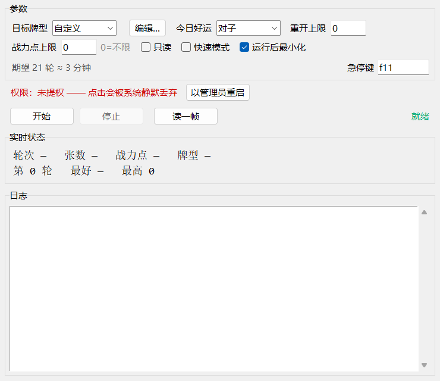
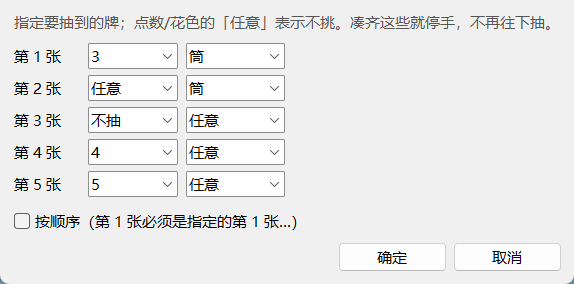

# 百趣演武 · 自动抽牌

《明日方舟：终末地》活动 **百趣演武（Arena of Games）** 的自动抽牌小工具。

它替你干一件事：**反复抽牌、判牌型，凑不到就重开，凑到了就停手叫你。**

- 镀层要的 **同花**，按概率平均要重开 **40 次**
- **同花顺**要 **1739 次**，机器大约要跑 **4 小时**

> 电脑版和安卓版是一套判定逻辑：本文先讲电脑版，**手机版见下面「安卓版」一节**。

> ### ⚠️ 请注意
> 本工具通过模拟鼠标点击来操作游戏，属于第三方辅助。鹰角《公平运营声明》点名禁止
> "宏脚本、自动挂机"，**有封号风险**，用不用请自己权衡。
> 本项目仅供学习交流，请勿用于任何商业用途。

---

## 它能做什么

| | |
|---|---|
| **刷 8 种标准牌型** | 对子 / 两对 / 三条 / 顺子 / 葫芦 / 同花 / 四条 / 同花顺 |
| **自定义要哪几张牌** | 逐张指定点数/花色，可要求严格按抽取顺序，也可以只抽前 2~4 张；还能一次写好几种 |
| **多个目标一起要** | 「多选…」里勾几个能接受的牌型，比如同花顺/同花/顺子，搏不到好的还有保底 |
| **战力点上限** | 超过设定值就放弃重开，保证刷出来的这手是真打得动的 |
| **敌人黑名单 / 白名单** | 抽到名单里的敌人（或名单外的）直接弃，看图勾选，不用等牌型凑齐 |
| **自动认牌** | 实时显示抽到了哪几张、当前牌型、战力点合计、预估奖励点 |
| **第二轮自动停手** | 第二轮点「放弃挑战」等于退出整场演算，所以它不会在那儿乱动 |
| **急停热键** | 默认 **F11**，全局生效，按一下立刻停（界面里可改） |

它**不会**碰游戏内存、不会改游戏文件，也不会替你去打。

---

## 下载与运行

### 方式一：下载打包好的程序（推荐）

1. 点本仓库右上的 **Releases**，下载 **`bqyw-v1.1.3.exe`**
2. 解压/放到任意文件夹，比如 `D:\Tools\bqyw`
3. **双击运行** —— 会弹 UAC，点「是」

> 附件名是英文的，因为 **GitHub 会把 release 附件名里的中文剥掉**（传上去会变成
> `default.exe`）。下载后随便改成什么名字都行，程序不依赖自己的文件名。

> 程序在清单里写死了「必须以管理员运行」，双击一定弹 UAC，**没有"用普通权限跑起来"这个选项**。
> 因为游戏是提权进程，Windows 会把低权限程序发出的点击**直接丢掉**
> ——表现就是"点了没反应，也不报错"，实测连光标都移不过去。与其让人一头雾水，
> 不如一开始就把权限要到。

> 反过来说：点了 UAC 的「否」程序就不会启动，这是正常的。

> 首次运行如果被杀毒软件拦截，多半是 PyInstaller 打包的常见误报，加个信任即可。
> 程序会在自己旁边建一个 `logs\` 文件夹；如果放在 `C:\Program Files` 这类
> 受保护位置，日志会改写到 `%LOCALAPPDATA%\百趣演武自动抽牌\logs`。

### 方式二：从源码运行

装好 Python 3.9+ 后：

    pip install -r requirements.txt
    python gui.py

从源码跑没有清单约束，不是管理员时程序会提示，并提供「以管理员重启」按钮
（桌面上那个 `启动管理员.bat` 也行）。

---

## 开始之前，请确认

- [ ] 游戏是 **16:9** —— 1920×1080 或 2560×1440 都行（16:10、21:9 这类比例不支持）
- [ ] 游戏窗口**在最前面，没被别的窗口挡住**（它看的是屏幕画面，被挡住就会认错牌）
- [ ] 当前站在**抽牌界面**，而且是**第 1 轮**
- [ ] 程序是**以管理员身份**运行的

---

## 怎么用

1. **选目标牌型** —— 下拉框里挑，或者点「多选…」勾几个都能接受的；
   选「自定义」则点「自定义…」写自己想要的牌
2. **（可选）填战力点上限** —— 比如填 12，抽到超过 12 点就自动放弃重开
3. 点 **开始**
4. 想停就按 **F11**

跑起来之后窗口会自动最小化（它压在游戏上会干扰识别）。界面上会实时显示：

    轮次 1   张数 3   战力点 15   牌型 三条
    第 7 轮   最好 同花   最高 216000

命中目标时程序会**响一声并停下**，光标留在游戏里，剩下的（开打、进第二轮）交给你。

每次开始都会在程序旁边的 `logs/` 里留一份日志，**只保留最近 5 份**，更旧的自动删掉。
遇到问题想反馈，把最新那份日志发过来就行。

---

## 目标怎么选

### 标准牌型

`对子 / 两对 / 三条 / 顺子 / 葫芦 / 同花 / 四条 / 同花顺`

下拉框旁边会直接显示**期望轮数和大概要等多久**，选之前就知道值不值。

### 多个目标一起要

点「多选…」，勾几个能接受的牌型就行（比如 同花顺 + 同花 + 顺子）。程序按基础倍率
**从高到低**排队：

1. 最想要的那个还有戏 → **继续抽**，搏它
2. 它没戏了 → 退到下一个目标
3. 勾中的全都成不了 → 才放弃
4. 已经凑到手的、容易碎的目标（同花 / 同花顺 / 自定义）→ **立刻收**，不赌

| 目标 | 期望重开 |
|---|---|
| 只要 同花顺 | 1,739 轮 |
| 只要 顺子 | 5.4 轮 |
| 同花顺 + 顺子 | 5.4 轮 |
| 同花顺 + 同花 + 顺子 | 4.9 轮 |

加几个保底几乎不增加时间，但每局都多留几次"白捡"的机会。

### 自定义：指定要哪几张牌

目标牌型选「自定义」，再点右边的「自定义…」：

- 每张牌选**点数**和**花色**，点数选「任意」表示只要是张牌就行（也可以配花色用，
  比如「任意筒」= 随便一张筒）
- **第 2 张起可以选「不抽」** —— 选了之后后面几张自动变灰，表示"凑齐前面这些就停手"
- 点**「+ 再加一组」**可以写好几手牌，**达成任意一组就停手**（比如「3 筒 3 筒」或
  「1 筒 2 筒 3 筒」都能接受，谁先成型算谁）
- 勾**「按顺序」**则第 1 张必须是指定的第 1 张，第 2 张必须是第 2 张……（对每一组都生效）

**顺序的代价非常大，差 120 倍**：

| 想要的手牌 | 不管顺序 | 要求按顺序 |
|---|---|---|
| 1筒 2筒 3筒 4筒 5筒 | 4,348 轮 | **521,730 轮** |
| 3筒 3筒 3索 5萬 5任意 | 5,797 轮 | **309,173 轮** |
| 5 5 5 5 5 | 1,104 轮 | 1,104 轮（五张一样，顺序无所谓） |

> 少于 5 张的目标**抽够就停**，绝不会多抽一张 —— 多抽一张就把刚凑好的牌冲掉了。

---

## 敌人黑名单：只留 / 只躲某些敌人

**牌面就是敌人。** 抽牌页那 5 张铭牌，立绘就是这局要打的敌人，所以可以「见到谁就直接弃」，
不用等牌型凑齐。界面「参数」里那一行 **敌人名单** 就是干这个的。

| 模式 | 什么时候放弃重开 |
|---|---|
| 关 | 永不（默认，不加载模板，零开销） |
| 黑名单 | 抽到**名单里**的敌人 |
| 白名单 | 抽到名单**外**的敌人（名单空着等于关） |

点「选择…」打开勾选面板：25 个敌人按**战力点分组**列出来，**看图勾，不用记名字**。

> 每个敌人只会在固定一个战力点出现（扫描 495 次抽牌、零例外），所以按点数分组 ——
> 勾的时候顺便就知道「这个 5 点怪一出，这手牌最多也就 25 点」。

### 它怎么认的

认的是**立绘**，不是名字，也不是等级：

- 数据溢出提级后 **Lv 会变、立绘不变**，所以裁剪框特意避开了 Lv.90 那一行；
- 名字条每张都带 ×N 后缀、文字居中还会整体移位，当模板必漏；
- 立绘比对用归一化互相关（NCC）：同一敌人两次抽到 **0.84~0.93**，不同敌人最高 **0.68**，
  阈值定 **0.78**，两边都留余量。

**认不准就不弃。** 分数不到阈值一律当「不认识」，只写一行日志（「第 3 张认不出敌人」），
绝不拿错的手牌去放弃 —— 宁可漏弃，不可误弃。

### 名单存在哪

勾完就存进程序旁边的 config.json：

    {
     "enemies": {
      "mode": "ban",
      "names": ["解燥", "断云叟"]
     }
    }

命令行也一样（优先级高于配置文件）：

    python main.py run --target 四条 --ban 解燥,断云叟      # 黑名单
    python main.py run --target 四条 --only 断云叟          # 白名单

### 两个安全阀

- **连着 20 轮都撞名单就停手**：多半是名单配得太宽（比如白名单只勾了 1 个），再跑也是空转；
- **名单里的名字模板库没有**时，开跑会直接提示 —— 拼错名字等于名单没生效。

### 已知限制

- 只认扫描到的 **25 个敌人**（100 轮、495 次抽牌，连续 38 轮零新增）。真出现没见过的敌人，
  不认识、不弃，日志里写一行；
- 敌人的**抗性**（物理/灼热/电磁/寒冷/自然，B/C/D）已经存在名单里，目前只用来展示，不参与判定。

---

## 抽牌节奏

游戏抽牌有冷却，实测**一张约 1.4 秒**：点下去到牌翻出来约 0.5 秒，之后还要等冷却走完。
程序按这个节拍点，一下点击对应一张牌；万一点空了会自动补一下，并把节拍往后调一点。

| | 实测 |
|---|---|
| 每张牌 | 约 1.4 秒（冷却就这么长，点早了游戏直接丢掉） |
| 每轮 | 约 5 秒（平均抽 3.3 张就知道没戏，撤） |

**「快速模式」已经删了**：它当年是为了绕开"每张牌都要等动画"，而现在节拍优化后
逐张判定反而更快（一轮 5 秒，连点铺满要 8~10 秒），还少打 3 个敌人。

---

## 大概要跑多久

| 目标 | 达成概率 | 期望重开 | 大约耗时 |
|---|---|---|---|
| 对子 | 95.3% | 1 次 | 10 秒 |
| 两对 | 31.2% | 3 次 | 半分钟 |
| 三条 | 25.3% | 4 次 | 半分钟 |
| 顺子 | 18.6% | 5 次 | 1 分钟 |
| 葫芦 | 5.18% | 19 次 | 3 分钟 |
| 同花 | 2.49% | 40 次 | 5 分钟 |
| 四条 | 2.51% | 40 次 | 5 分钟 |
| 同花顺 | 0.058% | 1739 次 | 4 小时 |

这些是**精确算出来的**，不是估的。同花顺那一档和社区独立算的数值完全一致。

---

## 安卓版

同一套逻辑的手机版：抓屏认牌 → 判牌型 → 没戏就重开 → 命中就停手叫你。牌型、自定义目标、
提前剪枝、按冷却节拍抽牌、敌人黑名单 / 白名单都在，区别只是设置改在**悬浮球**里点，
点按走系统能力而不是鼠标。

### 需要什么

- 安卓 9 以上的手机，游戏**横屏**运行
- **无障碍** 或 **Shizuku**，开一个就行（用来点屏幕）
- 悬浮窗权限（悬浮球）
- 抓屏授权（**每次重装或重启手机后要重新点一次**，这是安卓系统的限制，绕不过去）

### 怎么装

**下载安装包，直接在手机上装：**

1. 在仓库的 **Releases** 页下载 **`bqyw-android-v1.2.0.apk`**
2. 把它传到手机上 —— 微信文件传输助手、数据线、网盘都可以
3. 在手机上点开这个文件安装

> 附件名是英文的，因为 GitHub 会把 release 附件名里的中文剥掉。下载后随便改名都行，
> 安卓不依赖文件名 —— 但**别改扩展名**，必须是 `.apk`。

第一次装会提示「未知来源」，按提示给自己用的那个 App（文件管理器 / 浏览器 / 微信）打开
「允许安装应用」的权限。

部分品牌（vivo、OPPO 等）装的时候还会多弹一层自家风格的「继续安装」页面，底下带个勾选框
—— 这是系统自己的拦截，不是安装包有问题，点「继续安装」即可。

装完桌面会出现图标，名字是「百趣演武自动抽牌」。**以后更新版本直接装就行**，会覆盖旧版，
不用卸载 —— 卸载会把无障碍、悬浮窗这些授权一起清掉，还得重新配一遍。

> 想自己编译的话：装好 JDK 17 和 Android SDK，在 `android/` 目录下跑
> `gradle :app:assembleRelease`，产物在 `android/app/build/outputs/apk/release/`。

### 怎么用

打开 App，从上到下点一遍：

| 按钮 | 干什么 |
|---|---|
| ① 授权抓屏 | 系统弹窗选「共享一个应用」→ 选终末地 |
| ② 无障碍点按 | 跳到系统无障碍设置，打开「百趣演武自动抽牌」 |
| ③ 授权 Shizuku | 装了 Shizuku 的话只开这个也一样 |
| ④ 授权悬浮窗 | 第一次要去系统设置里开「显示在其他应用上层」 |
| ⑤ 显示悬浮球 | 球出现之后，所有操作都在球上 |

进游戏后**点一下悬浮球**展开面板：

- **牌型**：自定义 / 对子 / 两对 / 三条 / 顺子 / 葫芦 / 同花 / 四条 / 同花顺
- **目标点数**：5 个格子，每格可选 任意 / 1~5 / 1~5 带花色
- **按顺序**：第 1 格 = 最左边那张
- **开始 / 停止**，下面一行显示当前状态和最后一条日志

球可以拖到不挡牌桌的位置，面板展开时会自己挪回屏幕内。

### 两种点按方式

| | 无障碍 | Shizuku |
|---|---|---|
| 要装东西 | 不用 | 要装 Shizuku |
| 重启手机后 | 一直有效 | 要重新开无线调试并授权 |
| 代价 | 系统常驻一条「无障碍已开启」 | 无 |

两个都开着时优先走无障碍，某一下点不出去会自动换另一种补救。

### 和 PC 版不一样的地方

- **提前剪枝更严**：PC 版判的是「目标牌型出现在这手牌成立的所有牌型里」，安卓版要求
  「最终生效的牌型就等于目标」。比如目标是三条、结果凑成葫芦，PC 版算命中，安卓版不算
  —— 游戏本身取的就是倍率最高的那个。
- 没有战力点上限、没有重开上限、没有急停热键（在球上按停止即可）。
- **敌人名单有**，而且在悬浮球的「敌人」页里设：三档（关 / 黑名单 / 白名单），25 个敌人
  按战力点分 5 组、缩略图 + 名字，点一下就切换。名单存在本机，重启手机也还在。
  不勾就是关，关着零开销 —— 模板都不加载。

### 已知限制

- **游戏内「边距 / 安全区」设置必须保持 0。** 它挪的是整个界面，一旦不为 0，下面那些
  标定坐标会整体偏移：认牌认不出、点击点到空处。分辨率变了程序会自己换算，边距变了不会。
- 坐标按 **2800×1260（20:9）** 实机标定。程序按「游戏把 20:9 的画布等比塞进窗口居中」换算，
  所以 20:9 的任何分辨率都等价，16:9 / 19.5:9 / 21:9 也走同一套换算 —— 但**非 20:9 只在
  模拟环境里验过缩放模型，没在真机上端到端跑通**。
- **今日好运组合不会自动识别**，所以预估奖励点会少算翻倍的那一份。
- 命中后只停手，不替你去打。

---

## 常见问题

**Q：点了开始，游戏里一点反应都没有。**
A：打包版不会这样 —— 它启动时就强制要到了管理员权限。
如果是**从源码跑的**，看界面顶部那行权限提示：显示「权限：未提权」就点旁边的「以管理员重启」。

**Q：提示「抓到的画面不是抽牌界面」。**
A：一般是游戏被别的窗口挡住了、最小化了，或者你不在抽牌页。把游戏切到最前面再点开始。

**Q：为什么跑到第二轮它自己停了？**
A：第二轮点「放弃挑战」是**退出整场演算**，不是清牌重来。所以程序只会在第一轮刷牌，进第二轮就交还给你，免得把你辛苦凑的一轮白扔掉。

**Q：勾了黑名单，怎么一次都没弃？**
A：先翻日志找「第 N 张认不出敌人」那一行 —— 立绘分数不到 0.78 时它宁可不动手。
常见的两个原因：游戏内「边距 / 安全区」不是 0（整个界面会挪位），或者画面被别的窗口压着。

**Q：认错牌了怎么办？**
A：程序会拿手牌点数之和跟左下角战力点表格的高亮列对一遍，对不上会在日志里提示。偶尔对不上是正常的（表格滚动比手牌慢半拍），不影响结果 —— 它不会基于表格读数去点放弃。如果频繁出错，先确认分辨率和遮挡。

**Q：电脑版支持哪些分辨率？**
A：**16:9 都行**。1280×720、1920×1080、2560×1440、1600×900 都**实机跑通过**
（抽牌、放弃、确认都点在正确位置）；其中 720p / 1080p / 1440p 还各跑过 **100 轮**的
黑名单回归（1.43~1.45 秒/张，零漏认、零误弃）。3840×2160 只做过等比换算验证 ——
把参考图放大 1.5× 后识别全对，但没在真 4K 屏上跑过。

> 小画面有个坑值得一提：720p 下卡头数字只有 20px 高，二值化后的闭运算核如果还是 3×3，
> 会把数字和旁边的花色图标糊成一块。现在核跟着缩放走（≥0.7 才用 3×3），720p 就正常了。

16:10、21:9 这类比例**不行**：界面不是等比缩放，而是重新排布，硬套坐标会点歪。
程序检测到比例不对会直接停下，并在日志里写明原因，不会闷头乱点。

**Q：安卓版呢？**
A：坐标按 20:9 的 2800×1260 实机标定，其它分辨率靠「游戏把 20:9 画布等比塞进窗口居中」
这条换算过去，换了分辨率不用重新设置。但**游戏里的「边距 / 安全区」必须保持 0**，
它一变所有坐标都会整体偏移。

**Q：换了分辨率要重新设置吗？**
A：不用。程序每次启动都读游戏窗口的实际大小。窗口化运行时窗口摆哪都行，
点击坐标已经按客户区位置补偿过了。

**Q：会被封号吗？**
A：有可能。见文首的风险提示。这类工具在所有二游都属于违规，请自己决定。

**Q：杀毒软件说这是病毒。**
A：PyInstaller 打包的鼠标自动化程序几乎都会被误报。介意的话可以下载源码自己跑。

**Q：双击了没反应，或者一闪就没了。**
A：先看是不是点了 UAC 的「否」—— 点否就什么都不发生。
排除这个之后，在 exe 所在目录打开命令行跑一句
`bqyw-v1.1.3.exe --selftest`（这一步也会弹 UAC），
它会把"版本 / 模板 / 依赖 / 日志目录"逐项检查一遍并写进日志。
把 `logs\` 里最新那份发出来就能定位。

**Q：日志留在哪，会不会越堆越多？**
A：在程序旁边的 `logs\` 里，**只保留最近 5 份**，更旧的自动删掉。

**Q：内存占用好几百 MB，跑久了还往上涨？**
A：v1.1.2 起两处根源都堵掉了：

- numpy 一导入，它背后的 OpenBLAS 就按 CPU 核数开线程池，每个线程一块 32MB
  计算缓冲 —— 16 核就是 **512MB**，而本程序根本不做矩阵运算。现在把这几个
  线程数按 1 写死，提交内存从约 560MB 降到约 60MB。
- 抽牌轮询以前每次都重抓整屏（14.7MB 一次，而抽一张牌要轮询几十次），
  现在只抓卡片条带（0.7MB）和按钮那一小块（72KB），临时分配少了两个数量级。

平时日志里每 5 分钟会写一行 `[内存] 占用 … MB（提交 … MB，峰值 … MB）`，
数字明显变了才写。想核对时直接翻日志，比看任务管理器清楚——
任务管理器里「内存」是专用工作集，「提交大小」才是提交内存，两者差很多。

---

## 关于这个活动（工具依据的规则）

理解这些能帮你知道它在等什么。

**牌堆**：每局 34 张，战力点 1~5 各 6/6/6/6/10 张，无放回抽最多 5 张。战力点合计超过 10 会「数据溢出」，敌人变强。

**牌型与倍率**：

| 牌型 | 条件 | 倍率 |
|---|---|---|
| 散牌 | 什么都没凑成 | 1.0 |
| 对子 | 2 张同战力点 | 1.2 |
| 两对 | 两对 | 1.4 |
| 三条 | 3 张同战力点 | 1.6 |
| 顺子 | **4 张**战力点连续 | 1.8 |
| 葫芦 | 3 张 + 一对 | 2.0 |
| 同花 | **手上每一张**都同花色，且至少 4 张 | 4.0 |
| 四条 | 4 张同战力点 | 6.0 |
| 同花顺 | 5 张同花色且连续（只能是 12345） | 8.0 |

两个容易搞错的地方：

1. **顺子只要 4 张**，不是扑克那样 5 张。
2. **同花要求手上的牌全都同色** —— 凑到 4 张同花后，第 5 张抽到异色会**当场把同花弄丢**。

多牌型同时成立时只取**基础倍率最高**的那个；命中当日「好运组合」则该倍率**翻倍**（今天是对子 2.4 倍）。

**战力点 → 底分**：

    1:1千  2:3千  3:6千  4:1万  5:1万5  6:2万  7:2万5  8:3万  9:3万5  10:4万
    11:5万 12:6万 13:7万 14:8万 15:9万 16:10万 17:11万 18:12万 19:13万 20:15万(上限)

**两轮制**：第一轮拿到的奖励点会给第二轮底分加成，加成系数 = `第一轮奖励点 ÷ 10万 + 1`。
（比如第一轮 60 万 → 第二轮底分是 7 倍。）

---

## 许可

以 **Mozilla Public License 2.0（MPL-2.0）** 发布，全文见 [LICENSE](LICENSE)。

可以商用、修改、再分发；要求是对本项目源码的修改同样以 MPL 2.0 公开，并保留版权声明。
它不像 GPL 那样连累你的其他项目。

    This Source Code Form is subject to the terms of the Mozilla Public
    License, v. 2.0. If a copy of the MPL was not distributed with this
    file, You can obtain one at https://mozilla.org/MPL/2.0/.